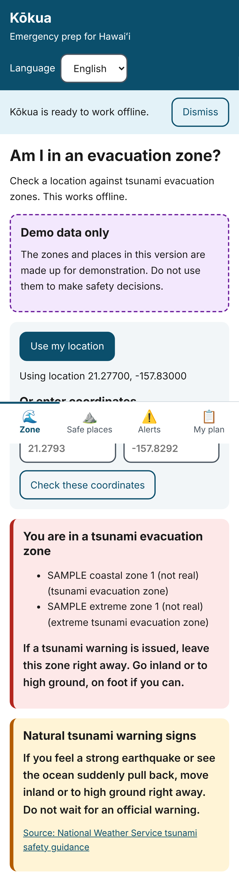
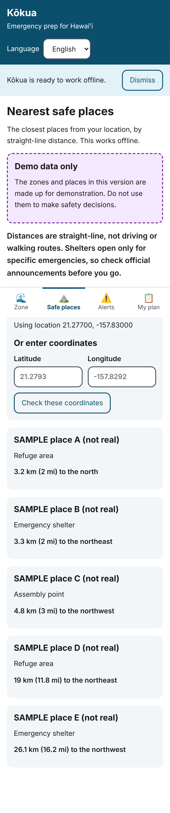
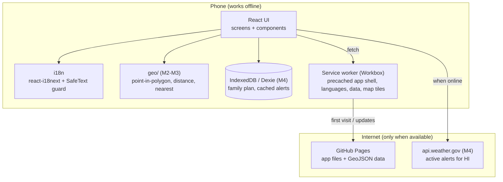

# Kōkua

**Offline-first, multilingual emergency preparedness for Hawaiʻi.**

During hurricanes, tsunamis, and wildfires, cell service and power often fail exactly when
people need information most. Many Hawaiʻi residents are also more comfortable in a
language other than English. Kōkua is an installable web app that keeps working with zero
connectivity: it tells you whether you're in a tsunami evacuation zone, where the nearest
safe place is, what alerts were last issued, and what your family's plan is, in your
language.

> Example project by Skylor Chan, built with heavy AI assistance (Claude Code). Most of
> the code is AI-generated; see [`AI_USAGE.md`](AI_USAGE.md) for exactly what. It is not
> a contest submission.

**Status:** Milestones 1-3 (offline app shell, English + Japanese, zone check, nearest
places). The zones and places shipped right now are **made-up sample data**, labeled as
such in the app. Run `npm run data:fetch` to swap in the official zones.

| English                                                                               | Japanese, in airplane mode                                                                                                                                                                                 |
| ------------------------------------------------------------------------------------- | ---------------------------------------------------------------------------------------------------------------------------------------------------------------------------------------------------------- |
|  |  |

| Zone check (sample data)                                                                                                  | Nearest places (sample data)                                                                                           |
| ------------------------------------------------------------------------------------------------------------------------- | ---------------------------------------------------------------------------------------------------------------------- |
|  |  |

## Features

| Feature                                                           | Status                             |
| ----------------------------------------------------------------- | ---------------------------------- |
| Installable, works fully offline after first visit                | ✅ M1                              |
| English + Japanese UI, with a safety-translation guard            | ✅ M1                              |
| "Am I in an evacuation zone?" (GPS or typed coordinates, offline) | ✅ M2 (sample data; map tap later) |
| Nearest safe places with straight-line distance and direction     | ✅ M3 (sample data)                |
| Live NWS alerts with cached copy and "last updated" age           | M4                                 |
| Family plan: checklist, meeting points, contacts, printable + QR  | M4                                 |
| 10 languages, large-text and high-contrast modes, WCAG 2.1 AA     | M5                                 |

## Architecture



**Key design decisions**

- **Offline-first via a custom service worker.** On the first visit, the service worker
  downloads and stores the entire app (including every language). After that, the app
  opens and works in airplane mode. Updates wait for the user to tap "Reload" so the app
  never changes mid-emergency.
- **Safety-translation guard.** Every non-English string is flagged in
  [`translation-status.json`](src/i18n/translation-status.json) as `machine` or
  `reviewed` (with the reviewer and date). Safety instructions (`safety.*` keys) are only
  shown in another language once a human has reviewed them; until then, the app shows the
  English original plus a note. A test fails the build if any string is unflagged.
- **Geo engine with no dependencies.** `src/geo/` does ray-casting point-in-polygon
  (edges count as inside, holes and multipolygons supported), haversine distance, compass
  bearing, and nearest-place search. Outside the dataset's coverage area the app refuses
  to answer instead of saying "not in a zone".
- **Hash URLs** (`/2425/#/places`) so links work on GitHub Pages, which can't rewrite URLs.
- **No accounts, no API keys, no tracking.** Everything personal stays on the device.

## Development

Requires Node 22.

```bash
npm install
npm run dev          # dev server (no service worker)
npm run build        # production build to dist/
npm run preview      # serve the build at http://localhost:4173/2425/
npm run lint         # ESLint, including accessibility rules
npm run typecheck
npm test             # unit tests (Vitest)
npm run e2e          # end-to-end tests incl. airplane mode (Playwright)
npm run i18n:sync    # flag new translated strings as "machine"
npm run data:fetch   # download official tsunami zones (needs geodata.hawaii.gov)
```

To test offline by hand: `npm run build && npm run preview`, open the site in Chrome, then
DevTools → Network → set to Offline, and reload.

## Data sources

See [`DATA_SOURCES.md`](DATA_SOURCES.md). All data comes from official public sources,
and every dataset shows its "last updated" date in the app.

## AI use disclosure

See [`AI_USAGE.md`](AI_USAGE.md). The geographic algorithms in `src/geo/` were originally
planned as student-written, but were written by AI on 2026-10-25 when the project became
an example project.
