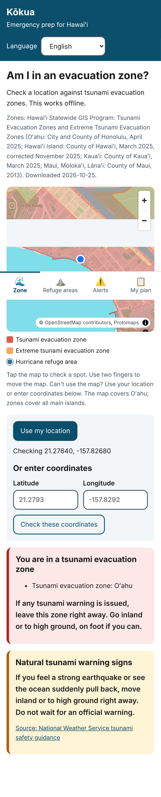
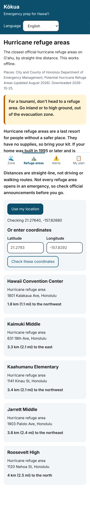
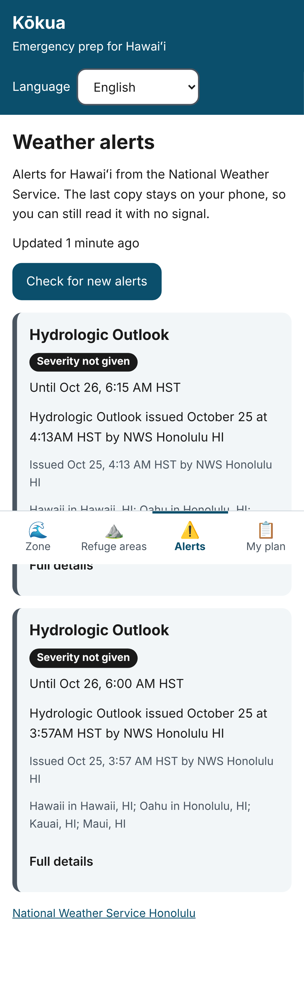
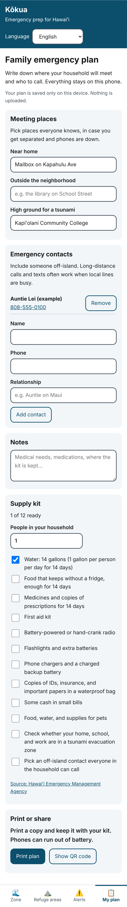
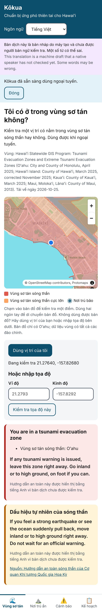
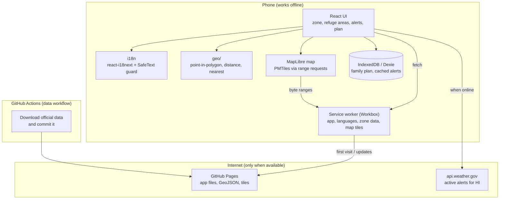

# Kōkua

**Offline-first, multilingual emergency preparedness for Hawaiʻi.**

During hurricanes, tsunamis, and floods, cell service and power often fail exactly when
people need information most. Many Hawaiʻi residents are also more comfortable in a
language other than English. Kōkua is an installable web app that keeps working with zero
connectivity: it tells you whether you're in a tsunami evacuation zone, shows the zones on
a map, lists the nearest hurricane refuge areas, keeps the last weather alerts on your
phone, and holds your family's emergency plan.

> Example project by Skylor Chan, built with heavy AI assistance (Claude Code). Most of
> the code is AI-generated; see [`AI_USAGE.md`](AI_USAGE.md) for exactly what. It is not
> a contest submission.

| Zone check and map                                                                                                                            | Refuge areas                                                                                                         | Weather alerts                                                                                                | Family plan                                                                                                                   |
| --------------------------------------------------------------------------------------------------------------------------------------------- | -------------------------------------------------------------------------------------------------------------------- | ------------------------------------------------------------------------------------------------------------- | ----------------------------------------------------------------------------------------------------------------------------- |
|  |  |  |  |


<br>Vietnamese (machine draft): safety instructions stay in English until a person reviews
the translation.

## Features

| Feature                                                                                 | Data                                             |
| --------------------------------------------------------------------------------------- | ------------------------------------------------ |
| Installable; works fully offline after the first visit                                  |                                                  |
| "Am I in an evacuation zone?" from GPS, a map tap, or typed coordinates                 | Official statewide tsunami zones                 |
| Separate guidance for the regular and the extreme tsunami evacuation zone               | Official                                         |
| Offline street map of Oʻahu with the zones and refuge areas drawn on it                 | OpenStreetMap via Protomaps                      |
| Nearest hurricane refuge areas on Oʻahu with distance and direction                     | Honolulu Department of Emergency Management      |
| National Weather Service alerts, saved on the phone, with their age and a stale warning | Live (api.weather.gov)                           |
| Family plan: meeting places, contacts, notes, 14-day kit checklist, print, QR           | Stays on the device                              |
| 8 languages, with a guard that keeps unreviewed safety text in English                  | See [`docs/TRANSLATING.md`](docs/TRANSLATING.md) |

Not done yet: large-text and high-contrast modes, a full WCAG 2.1 AA audit, Chuukese and
Marshallese (need a human translator), human review of every translation.

## Download and run it

You need [Node.js 22](https://nodejs.org) (the LTS installer is fine) and, optionally,
[Git](https://git-scm.com).

```bash
git clone https://github.com/skylorchan/2425.git
cd 2425
npm install
npm run dev
```

Then open the address it prints (usually http://localhost:5173/2425/). No Git? On GitHub,
click **Code → Download ZIP**, unzip it, open a terminal in that folder, and run the last
two commands.

To try it the way a phone would (installable, works offline):

```bash
npm run build
npm run preview      # http://localhost:4173/2425/
```

Open that in Chrome, then DevTools → Network → Offline, and reload.

## Architecture



**Key design decisions**

- **Offline-first via a custom service worker.** The first visit stores the whole app,
  every language, the 2.3 MB zone file, and a 4.9 MB Oʻahu map. After that it opens and
  works in airplane mode. Updates wait for the user to tap "Reload" so the app never
  changes mid-emergency.
- **Map tiles as one file.** The basemap is a single PMTiles file that MapLibre reads in
  small byte ranges. The service worker keeps the whole file and answers those range
  requests from it, so the map works with no signal.
- **Safety-translation guard.** Every non-English string is flagged in
  [`translation-status.json`](src/i18n/translation-status.json) as `machine` or
  `reviewed`. Safety text (`safety.*`: zone results, evacuation advice, kit items) is shown
  in another language only after a person reviews it; until then the app shows English
  plus a note. Tests fail if a string is unflagged or a `{{placeholder}}` goes missing.
- **Honest answers at the edges.** A point on a zone boundary counts as inside. Outside
  the data's coverage the app says it can't tell you, instead of "not in a zone". Refuge
  areas come with Honolulu DEM's own warnings, and a reminder that a tsunami means going
  inland or uphill, not to a shelter. Cached alerts always show their age.
- **Data fetched in CI.** `.github/workflows/data.yml` downloads the official layers on a
  GitHub runner and commits them, so the build never depends on those servers being up.
- **Hash URLs** (`/2425/#/places`) so links work on GitHub Pages.
- **No accounts, no API keys, no tracking.** Everything personal stays on the device.

## Development

```bash
npm run dev          # dev server (no service worker)
npm run build        # production build to dist/
npm run preview      # serve the build at http://localhost:4173/2425/
npm run lint         # ESLint, including accessibility rules
npm run typecheck
npm test             # unit tests (Vitest)
npm run e2e          # end-to-end tests incl. airplane mode (Playwright)
npm run i18n:sync    # flag new translated strings as "machine"
npm run i18n:new -- <code>   # start a new language from English
npm run data:fetch   # download official zones and refuge areas (needs network access)
```

If Playwright can't find its browser (for example in a cloud dev container with a
preinstalled Chromium), point it there: `PW_CHROMIUM_PATH=/path/to/chrome npm run e2e`.

To refresh the data, run the **Data** workflow from the Actions tab (tick "refresh tiles"
to also rebuild the map), or push a change under `scripts/data/`.

## Data sources

See [`DATA_SOURCES.md`](DATA_SOURCES.md) for every dataset, its license, and when it was
downloaded. The app shows each dataset's source and download date.

## AI use disclosure

See [`AI_USAGE.md`](AI_USAGE.md).
